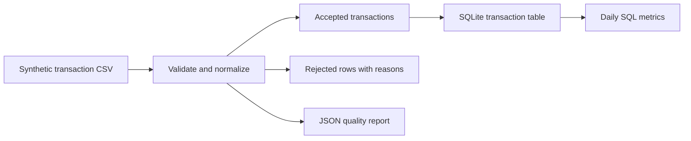

# Banking Transaction Data Pipeline

A local data engineering project that turns synthetic bank transactions into validated records, a quality report, and daily analytics in SQLite.

Built as a portfolio project by **Mano Anasani**. Uses Python's standard library, so no cloud account, API key, or third-party package is required.

## What it demonstrates

- CSV ingestion and explicit data contracts
- Deterministic synthetic data with intentional quality defects
- Validation, duplicate detection, and rejected-record auditing
- Atomic, idempotent SQLite batch loading
- SQL aggregations and operational reporting
- Automated tests for money handling, rejected data, and repeat runs

## Data flow



## Run it

Install Python 3.10 or later. From this repository folder:

```sh
python -m banking_pipeline.generate --output data/transactions.csv --rows 1000 --seed 42
python -m banking_pipeline.run --input data/transactions.csv --output-dir artifacts
python -m unittest discover -s tests -v
```

On Windows, `py` can be used instead of `python` if needed.

The generator adds six intentionally defective rows after the requested number of valid rows. All names and account identifiers are fictional. No real customer data is included.

## Outputs

| File | Purpose |
| --- | --- |
| `artifacts/banking.sqlite` | Queryable accepted transaction dataset and daily metrics view |
| `artifacts/daily_metrics.csv` | Daily transaction counts, credit/debit totals and net flow |
| `artifacts/rejected.csv` | Original rejected rows plus validation reasons |
| `artifacts/quality_report.json` | Input fingerprint, row counts, acceptance rate and rejection reasons |

The pipeline prints a concise run summary. Each run replaces the local transaction table with the accepted contents of that input batch. It does not append duplicates on reruns. Existing data is replaced inside a database transaction. Exports are regenerated afterward; exports and the database are not one cross-file transaction.

## Data contract

Required columns: `transaction_id`, `account_id`, `transaction_date`, `transaction_type`, `amount`, `currency`, `merchant_category`.

- IDs and merchant categories must be nonempty.
- Dates use strict `YYYY-MM-DD` formatting.
- Types are `credit` or `debit`; case is normalized.
- Amounts must be positive, finite USD values with at most two decimal places, up to $1 billion per transaction. They are stored as **integer cents**, avoiding floating-point currency arithmetic.
- Only USD is supported; currency case is normalized.
- The first **valid** occurrence of a transaction ID wins. Later valid occurrences are rejected as duplicates. An invalid row does not reserve its ID.
- Unexpected columns or a different column order are rejected at the file level to make schema drift visible. Missing or extra values in an individual row are rejected at the row level.

## Example SQL

```sql
SELECT * FROM daily_metrics ORDER BY transaction_date;

SELECT merchant_category,
       COUNT(*) AS transactions,
       SUM(amount_cents) AS total_cents
FROM transactions
WHERE transaction_type = 'debit'
GROUP BY merchant_category
ORDER BY total_cents DESC;
```

## Repository layout

```text
banking_pipeline/   Generator, validation, loading, and analytics
tests/             Integration and validation tests
.github/workflows/ Automated tests on pushes and pull requests
data/              Generated inputs (ignored)
artifacts/         Generated outputs (ignored)
```

## Design choices and limits

SQLite keeps the demo reproducible on a laptop. Validation is intentionally transparent rather than hidden behind a framework. The pipeline reads the batch into memory and is intended for portfolio-scale inputs; it is not a distributed processing or real-time banking platform. Quality checks identify malformed data, not fraud. No regulatory-compliance claim is made.

Possible extensions include incremental loading, Airflow scheduling, a dbt warehouse layer, and cloud object storage. These are future ideas, not implemented capabilities.

## Publish to your GitHub

1. Create an empty repository named `banking-data-pipeline` on GitHub. Do not initialize it with a README.
2. Upload the contents of this folder using **Add file → Upload files**, or run the commands below from this folder, replacing `YOUR_USERNAME`.

```sh
git init
git add .
git commit -m "Build banking data pipeline with validation and SQL analytics"
git branch -M main
git remote add origin https://github.com/YOUR_USERNAME/banking-data-pipeline.git
git push -u origin main
```

Suggested repository description: **Python and SQL banking data pipeline with synthetic transactions, quality checks, SQLite analytics, and automated tests.**

## License

MIT. See `LICENSE`.
